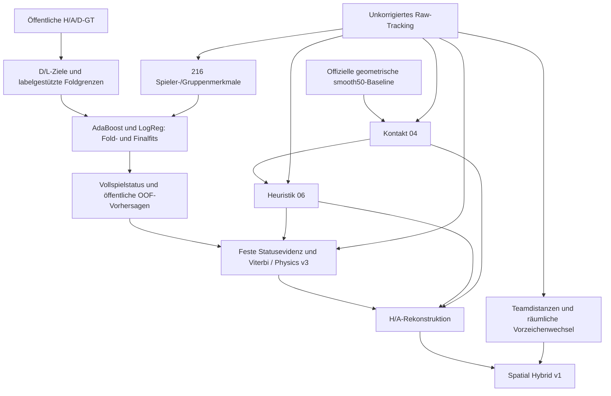

# Trainingslabel- und Datenherkunft

Auditdatum: **29. Oktober 2026, Europe/Berlin** (Clientdatum). Projekt: `/Volumes/T7/More Than A Hack 2027/Initial Challenge`. Online-Stand: `f8f2629ff1e0985f81d7e59d8413678514ee1530`. Lokales Archiv: `3de6b60aeabd2475d95879a651d38b72bc4fba00`. Technische UTC-Abrufzeiten und SHA-256 stehen in [Versionsmanifest](evidence/official_version_manifest.json). Alle Aussagen betreffen den vorgefundenen Stand; keine nachträgliche Änderung der Entwicklungshistorie.


## Wichtigster Befund

**AdaBoost und logistische Regression wurden nachweislich auf der öffentlichen offiziellen GT dieses Spiels trainiert.** Es handelt sich weder um externe Trainingslabels noch um automatisch erzeugte Pseudolabels. [E01](evidence/CODE_EVIDENCE.md#e01), [E02](evidence/CODE_EVIDENCE.md#e02), [E03](evidence/CODE_EVIDENCE.md#e03), [E04](evidence/CODE_EVIDENCE.md#e04). Die Statuslabels gelangen indirekt über die Vorhersagen und den Statusdecoder bis zu Spatial Hybrid v1. Eine spätere Speicherung in CSV oder NPZ ändert diese Herkunft nicht.

## Tatsächlich nachgeprüfte Labelableitung

Notebook 08, Zellindex 5, liest `evaluation/gt/BAR-ATH_possession_gt_public.csv` aus dem Archiv. Danach:

```python
public_mask = gt['label'].ne('X').to_numpy()
y_dead = gt['label'].eq('D').to_numpy(dtype=np.uint8)
```

Es sind **7.500 Frames 11185–18684**, davon 3.454 H, 2.577 A und 1.469 D. Zielvariable ist D gegen L, wobei L = H oder A. Die außerhalb liegenden X werden nicht als Trainingsziele verwendet. Die gespeicherte `public_oof_predictions.csv` enthält dieselben offiziellen binarisierten Ziele; dies wurde für alle 7.500 Zeilen geprüft. Der Marker `public_training_region` im Vollspielcache entspricht exakt dieser Maske.

Notebook 08, Zellindex 16:

```python
full_train_idx = public_frames[public_frames % TRAIN_STRIDE == 0]
model.fit(features.loc[full_train_idx], y_dead[full_train_idx], ...)
```

Beide finalen Modelle nutzen **1.500 Trainingszentren von 11185 bis 18680**, jedes im öffentlichen GT-Bereich, darunter 293 D-Zentren. Es gibt je vier weitere Fold-Fits pro Methode, mit 770 / 911 / 1.174 / 1.285 Trainingszentren und 266 / 191 / 165 / 175 D-Zentren. Diese Zahlen stimmen mit `fit_records.csv` und der aus dem Code rekonstruierten Filterung überein. **Es wurde im Audit kein Fit gestartet und kein Joblib-Objekt deserialisiert.** Modellartefakte werden durch Hash, Quellcode, Fitaufzeichnungen und zugehörige Vorhersagecaches belegt; eine vollständige Trainingswiederholung ist ausdrücklich nicht Teil dieses Audits.

## Abhängigkeitskette



LogReg ist Vergleichsmodell; **der finale v1-Pfad verwendet AdaBoost**. Die Diagrammkante ist Labelherkunft, nicht die Behauptung, dass die GT-Datei bei jeder späteren Inferenz erneut geöffnet wird.

## Komponenten im Detail

| Komponente | Ziel / Quelle / tatsächlicher Datenfluss | Öffentliche GT und sonstige Einschränkungen |
|---|---|---|
| Offizielle Baseline smooth50 | Nächster beobachteter Track in metrischen Koordinaten, Mehrheit über ±50 Frames. Fehlende Zuordnung führt zu D. Kein Fit. | Build ohne GT; gespeicherte CSV bytegleich zum Archiv. Fenster als offizielle vorgegebene Referenz dokumentiert. D ist eine Heuristik, kein menschliches Unterbrechungslabel. [E34](evidence/CODE_EVIDENCE.md#e34) |
| Kontakt04 | RTS-Glättung, lokale Beschleunigungspeaks ≥4 m/s², nächster Track ≤2 m, Team aus XML. Innerhalb Baseline-LIVE ab Kontakt fortführen; Baseline-D bleibt. | Kein überwacht trainiertes Kontaktziel. GT erst nach Export für Vergleich/Fehleranalyse. Historische Unabhängigkeit aller gewählten Zahlen vom bereits gesehenen Fenster ist damit nicht bewiesen. [E19](evidence/CODE_EVIDENCE.md#e19) |
| Heuristik06 | Algorithmische tonale/Outside-Seeds, Gruppenbewegung, Ballbewegung und Neustartregel; Baseline-D oder zusätzliche D; Kontakt-Replay. | Kein Fit. GT wird nach Export gelesen. Bekannte öffentliche Entwicklungs-/Gegenbeispielszenen sind jedoch Teil des Prozesses; „vor GT-Vergleich“ innerhalb eines Notebooks beweist keinen erstmals ungesehenen Datensatz. [E18](evidence/CODE_EVIDENCE.md#e18) |
| AdaBoost / LogReg | D/L aus offizieller öffentlicher GT; 216 Spieler-/Gruppenmerkmale, Pipeline-Imputation, bei LogReg Skalierung, ausgeglichene Samplegewichte. | Direkte GT-Trainingsnutzung belegt, nach aktuellen Regeln unzulässig. Papier Lang et al. liefert Methodik, **keine** hier verwendeten extern trainierten Gewichte. [E01](evidence/CODE_EVIDENCE.md#e01), [E02](evidence/CODE_EVIDENCE.md#e02), [E03](evidence/CODE_EVIDENCE.md#e03) |
| Hierarchischer Viterbi | Feste Evidenztabelle je Heuristik-/AdaBoost-Kombination; danach zeitlicher Decoder. | Kein eigener Fit, aber GT-trainierte Eingangsmodelle. Feste Konstanten sind nicht als GT-frei zertifiziert. [E05](evidence/CODE_EVIDENCE.md#e05), [E06](evidence/CODE_EVIDENCE.md#e06), [E07](evidence/CODE_EVIDENCE.md#e07) |
| Physics v1/v2/v3 | Zusätzliche LIVE-Evidenz aus Ball/Spielerbewegung, Nähe und No-Ball-Abdeckung; Viterbi; v3 baut auf v1 auf. | Kein eigenständiges überwachtes Physiktraining. Trotzdem AdaBoost-Abhängigkeit und nachgewiesene öffentliche Leistungsdiagnosen. [E08](evidence/CODE_EVIDENCE.md#e08), [E09](evidence/CODE_EVIDENCE.md#e09) |
| H/A-Besitzrekonstruktion | Heuristik06-H/A hat Vorrang, Kontakt04 ist Fallback; Fill innerhalb modellierter LIVE-Segmente. | Keine direkte GT-Eingabe in Funktion; Segmente kommen jedoch vom belasteten Statuspfad. [E10](evidence/CODE_EVIDENCE.md#e10) |
| Kontakt-HMM v1 | Kontakt-Teambeobachtungen, Mismatchkosten 1,4, Teamwechsel 1,8, Anfangskosten 0,8; auf Physics-v3-LIVE-Segmenten. | Kein HMM-Fit gegen Zielspalten gefunden. Übernommener Status/Initialisierung hängt indirekt von GT-Fits ab. Nicht Eingang des finalen Hybrid v1. |
| Teamdistanzen / Bewegungsfeatures | Originalpositionen, XML-Teamzuordnung, differenzierte Bewegung; räumliche Marge dA−dH. | Keine Zielspalte im numerischen Rechenpfad. Manuelle Szenen-/GT-Vergleiche sind davon getrennte Entwicklungsnutzung. [E24](evidence/CODE_EVIDENCE.md#e24), [E33](evidence/CODE_EVIDENCE.md#e33) |
| Spatial Hybrid v1 | Physics-v3-Label und -Status plus räumlicher Vorzeichenwechsel; Suchradius höchstens 75 Frames und durch Nachbarwechsel begrenzt. | Finaler Algorithmus wählt Kandidaten relativ zum **Modellwechsel**, nicht zur GT. Der gesamte Pfad bleibt über Physics v3/AdaBoost belastet; öffentliche Timingdiagnose ging der Entwicklung voraus. [E14](evidence/CODE_EVIDENCE.md#e14), [E15](evidence/CODE_EVIDENCE.md#e15), [E16](evidence/CODE_EVIDENCE.md#e16) |

## OOF: wichtige Präzisierung

Original-05, Zellindex 4, ersetzt `ada_labels[oof_frames]` durch `oof['AdaBoost_median91']`. Notebook 10, Zellindex 3, reproduziert das exakt. Die OOF-Statuslabels unterscheiden sich an **615** öffentlichen Frames von den Full-fit-Labels. Es wäre daher falsch, den finalen öffentlichen Score pauschal als unmittelbaren In-Sample-Score des finalen AdaBoost-Fits zu bezeichnen. Es wäre ebenso falsch, OOF als regelkonforme externe Herkunft oder unabhängigen Challenge-Test auszugeben: Jeder dieser Fold-Fits lernt andere öffentliche Ziele desselben Spiels. Zusätzliche Grenzen der globalen Decoderbewertung stehen im Leakage-Bericht.

## Caches und exportierte Eingaben

- Geprüft: 139 einzigartige CSV-/NPZ-Schemas nach Inhalts-Hash; **keine Parquet-Datei im inventarisierten Bestand**. [Schema-Inventar](evidence/cache_schema_inventory.json).
- `movement_features.csv` hat nur `frame`, `player_speed_mps`, `moving_fraction`, `ball_speed_mps`, `ball_valid`, `ball_coverage`. Keine GT-Spalte in diesem Cache. Die AdaBoost-Merkmalliste enthält 216 ausdrücklich aufgeführte Kontextmerkmale; kein Frame-ID-/GT-/manuelles Zielmerkmal als Eingang gefunden.
- NPZ: `reference`, `status`, `proximity_margin_H`, `expected_hybrid`, `halves`, `n_frames`, `fps`. Die ersten vier sind Vollspielsequenzen. `reference` ist byteinhaltlich als Labelarray gleich zur eingefrorenen Physics-v3-CSV; `expected_hybrid` gleich zur eingefrorenen Hybrid-CSV.
- `expected_hybrid` und die Referenz-CSVs sind im Code nach der Berechnung Prüfwerte, kein Ersatz für rohe Physics-Eingänge. [E35](evidence/CODE_EVIDENCE.md#e35). Trotzdem enthält das NPZ bereits abgeleitete GT-belastete Modellzustände.
- Oracle-GT aus Zellindex 45 ist als Diagnose gekennzeichnet und nicht als Submission exportiert. Kein Rückfluss dieses Oracle-Arrays in den finalen Hybrid-Rechenweg gefunden. Das ist kein Freispruch für die vorherige Trainings- und Entwicklungsnutzung.
- Modellbestand: zwei lokale `.joblib`-Statusmodelle plus ein externer T-DEED-Checkpoint. Keine weiteren selbst trainierten Klassifikatoren im untersuchten Quellbestand gefunden. Das schließt nicht vorhandene, verlorene oder externe Entwicklung nicht aus.

Alle nachgerechneten Mengen, Framefilter und Gleichheiten stehen in [Datenherkunftsprüfungen](evidence/data_lineage_checks.json). Quelle ist das vorhandene Projekt, nicht nur Variablennamen oder nachträglich formulierte Methodik.

## Externe Modelle: gesonderter Herkunfts- und Rechteaudit (Audit E)

| Modell / tatsächliche Nutzung | Geprüfte Primärquelle / Code- und Gewichtsrechte | Trainingsherkunft / Matchüberschneidung / offene Punkte |
|---|---|---|
| T-DEED SoccerNetBall_challenge1, **im separaten Pilot benutzt**, nicht in v1 | [Quellcommit](https://github.com/arturxe2/T-DEED/tree/d953b4de8a2ad941c565e1683c5b07255cbe644e), Root GPLv3, beigefügte E2E-Spot-BSD-3-Clause und GSM-BSD-2-Clause; GSF-Herkunft verlinkt. Kein separat ausdrücklicher Lizenztext für den Drive-Checkpoint gefunden. Lokale Lizenzdateien liegen bei. | Konfiguration: SoccerNet-Vortraining17 Klassen plus SoccerNetBall12 Klassen; Backbone-Konstruktion verwendet im Original timm-pretrained. Gefundene `train_challenge.json` nennt6 EFL-Spiele2019/20, kein Barcelona–Athletic 2024/25. Das ist keine vollständige Attestation jedes Vortrainings-/Finalcheckpoint-Laufs. **Vollständige Herkunft nicht verifizierbar**, keine belegte Matchüberschneidung. |
| Team T-DEED 2025, **nur als nächste Option empfohlen**, kein verwendetes Gewicht im Projekt | [Quellcommit](https://github.com/SoccerNet/sn-teamspotting/tree/091fed2fc35c33f7489f3596958a2fe385e37d65), GPLv3; konkret erreichbarer Drive-Endpunkt in Pilotmanifest, gesonderte Gewichtslizenz nicht belegt. | SoccerNet Team Ball Action Spotting, laut README Erweiterung derselben BAS-Spiele; Quelle/Split geprüft. Kein eigener Fit/Inferenz im Projekt. Trainingslogs und vollständige Weight-Provenienz offen; Links/Rechts-Teamhead noch nicht H/A-validiert. |
| FOOTPASS, **recherchierter Kandidat**, kein vollständiger Task-Checkpoint benutzt | [Quellcommit](https://github.com/JeremieOchin/FOOTPASS/tree/f63f37c1a0c6bcebf568a8ce716495a459376af5). Root-LICENSE Apache2.0; README nennt zugleich CC BY-NC4.0 für Annotations/Baselines. Diese zusätzliche/abweichende Angabe muss vor Nutzung auf Komponentenebene geklärt werden. | SN-PCBAS 2026, Videozugang separat über SoccerNet-NDA. Kein vollständig passender Task-Gewichtsdownload im geprüften Bestand. Codeverfügbarkeit allein beweist weder vollständige Inferenz noch eindeutige Gewichtsnutzungsrechte. |
| lRomul / sn-spotting / recokick / OpenSportsLab / weitere Rechercheprojekte | Im Pilotquellenvergleich dokumentiert, aber keine weiteren Checkpoints im inventarisierten Modellbestand. | Keine zusätzliche bereits verwendete Trainingsquelle behaupten. Vor einer späteren Aufnahme gelten eigene Prüfungen für Taskgewicht, Training, Rechte und Zugänglichkeit. |

Der tatsächlich vorhandene T-DEED-Checkpoint ist49.579.222 Byte groß, SHA-256 `f7b5cee134a2cfffc5b76922bbf528fe24cb6cc35c550dba23b9eb1bd4ff3d35`. Vorhandene Ausführungsmanifeste belegen striktes Laden598 Tensoren, fünf Clips/60s, feste CLI-Schwelle 0,2 und47 Vorhersagen. Die Primärquellen sind unter `artifacts/video_event_spotting/source/…` und `output/video_event_spotting_pilot/research/source_snapshots/…` gespeichert; URL-/Hashzuordnungen stehen in den dortigen Repository-/Source-Manifests. Diese Quellen wurden als Text erneut gelesen, Gewichte nicht erneut geladen oder trainiert.

**Regelauslegung:** Ein extern trainiertes Modell ist grundsätzlich zulässig, sofern zugänglich und dokumentiert und ohne verbotene personenbezogene Matchlabelquelle. Unvollständige Vortrainingskenntnis ist **nicht automatisch ein Regelverstoß**. Lizenz-/NDA-Fragen und eine mögliche unzulässige Übermittlung von Matchauszügen an einen gehosteten LLM sind davon unabhängige Fragen. Der lokale T-DEED-Forward-Pass setzt keine Cloudübermittlung voraus. Kein Modell wurde hier nach öffentlichem Besitzscore gewählt oder nachtrainiert.
